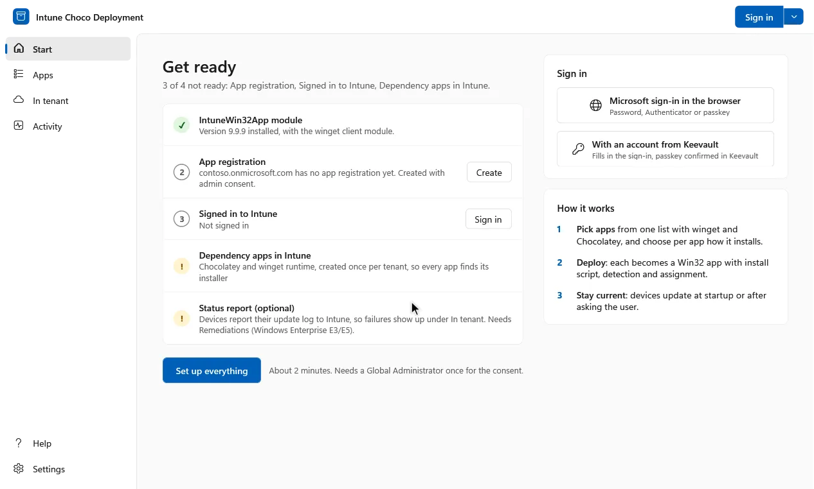
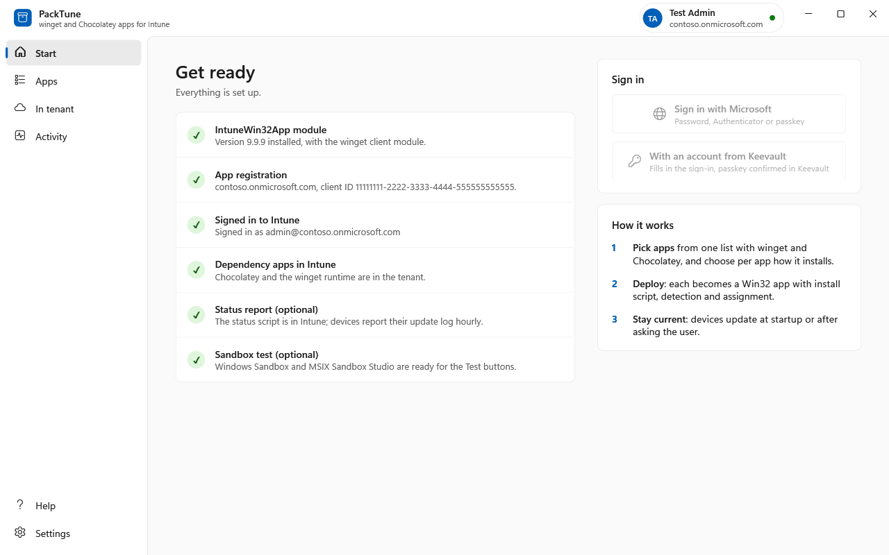
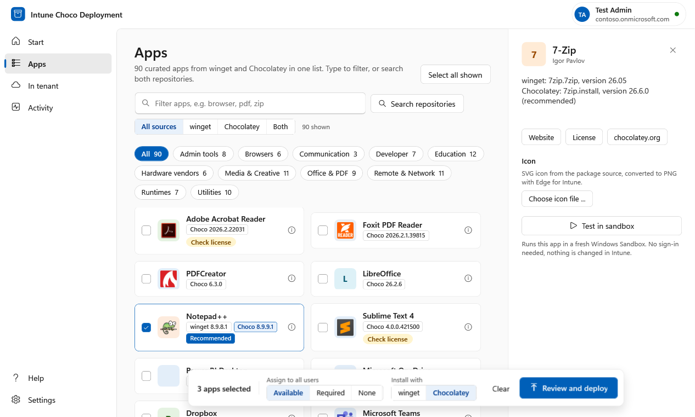
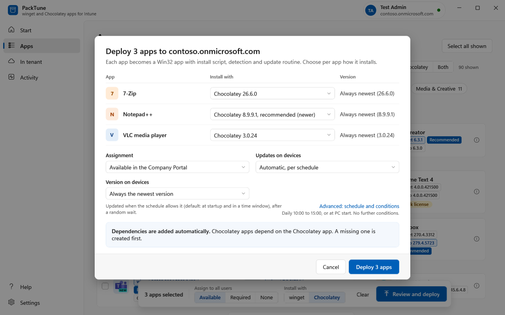
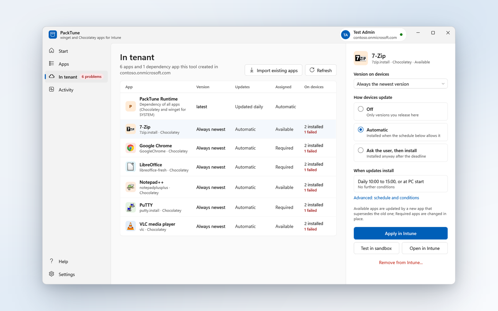
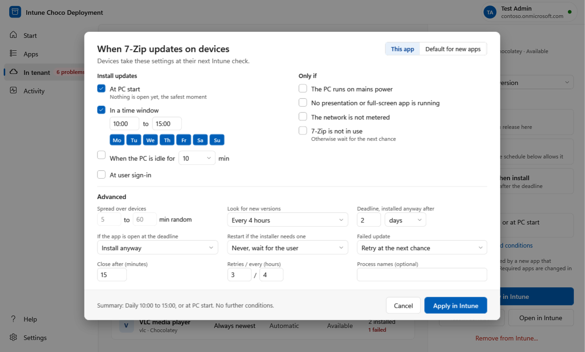
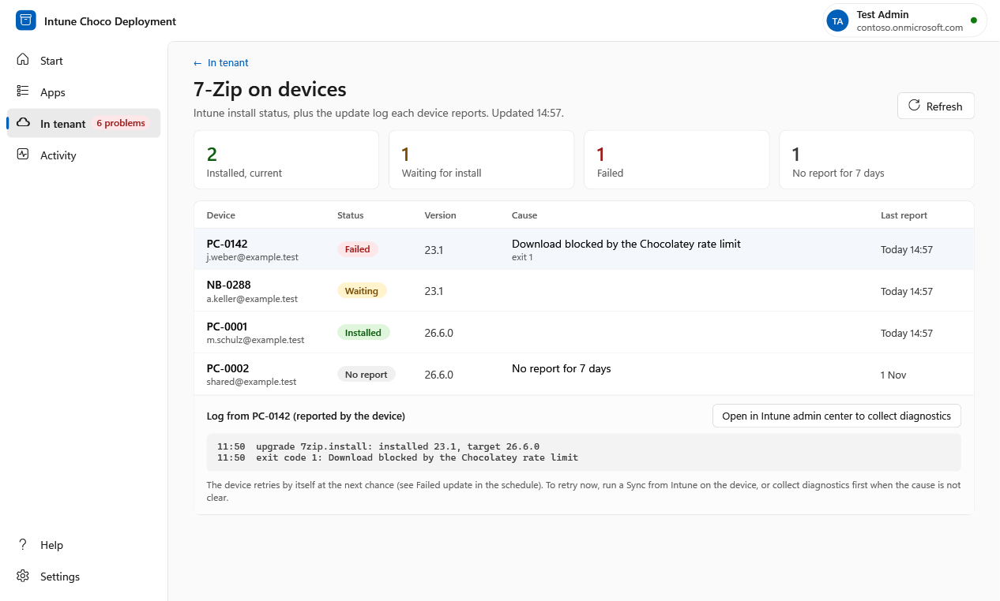
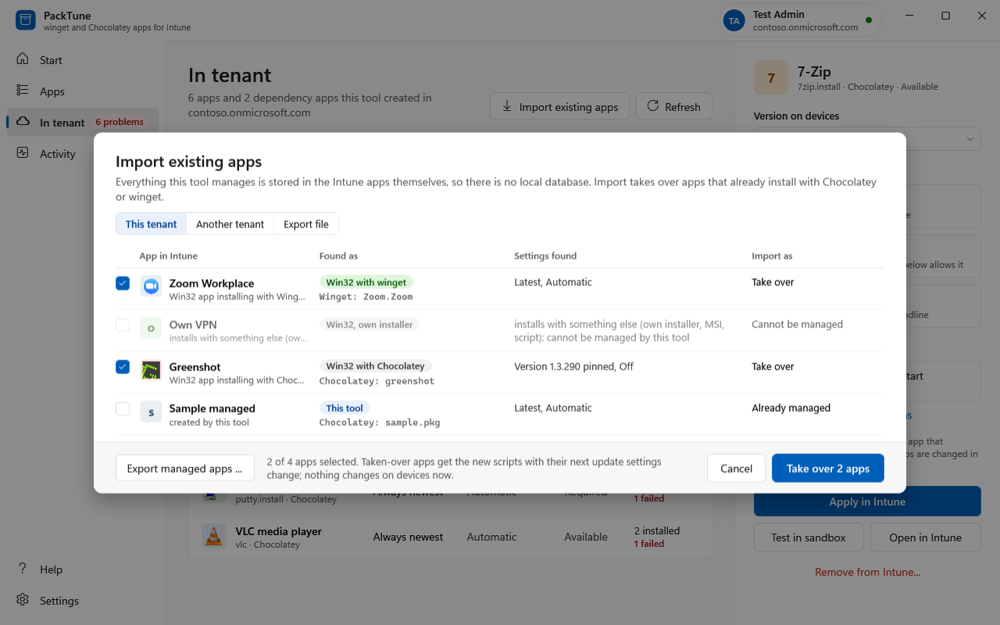
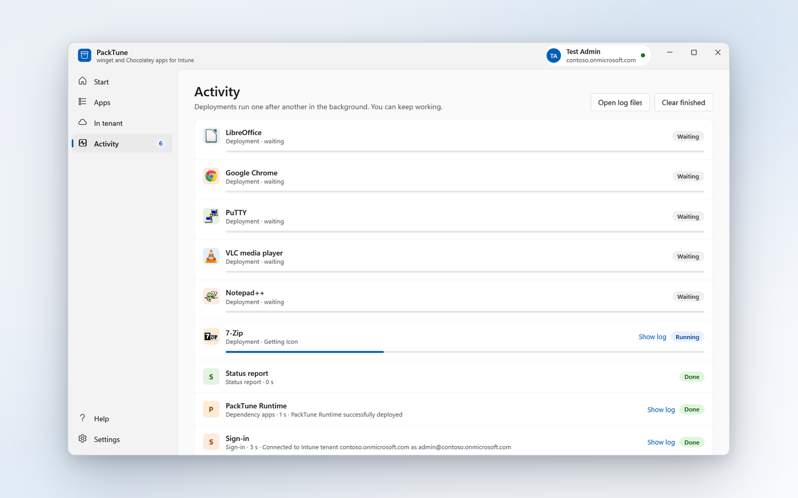
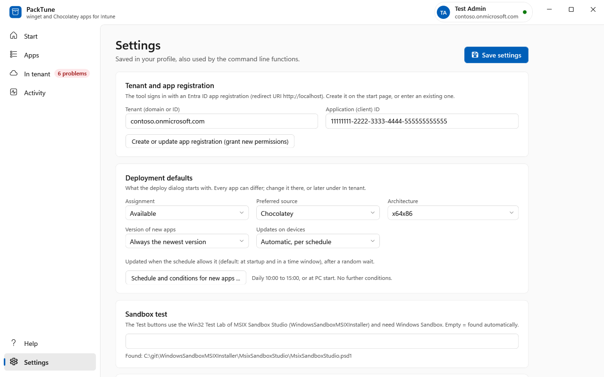

# PackTune

**winget and Chocolatey apps for Intune.** Publish winget and Chocolatey apps to Microsoft Intune as Win32 apps, keep them up to date on the devices, and see what happened on each device.



## What it does

- **One app list** for Chocolatey and winget. For each app the tool shows both versions and recommends the source with the newer one.
- **Deploys** each app as an Intune Win32 app with install script, detection rule, dependency app and assignment (Available, Required or None).
- **Keeps devices current** with a per-app update mode: Off, Automatic per schedule, or Ask the user with a grace period. Versions are either always the newest or pinned.
- **Releases new versions** from the tool: Required apps are updated in place, Available apps get a new app that supersedes the old one.
- **Shows the status** of every app: install status per device, the update log each device reports, and the cause of failures. It also imports apps that already exist in a tenant and tests packages in Windows Sandbox.

## Requirements

- Admin machine: Windows 10 or Windows 11. The graphical interface runs in Windows PowerShell 5.1; the command line works in Windows PowerShell 5.1 and PowerShell 7.
- The PowerShell module [IntuneWin32App](https://github.com/MSEndpointMgr/IntuneWin32App) 1.5.0 or newer, and `Microsoft.WinGet.Client` for winget. `Install-PackTuneComponents` installs both for the current user.
- Chocolatey and Inkscape are **not** needed on the admin machine: package infos and icons come from the chocolatey.org feed, SVG icons are converted with Microsoft Edge.
- An Entra ID app registration with these delegated Microsoft Graph permissions and admin consent:
  - `DeviceManagementApps.ReadWrite.All`
  - `DeviceManagementConfiguration.ReadWrite.All`
  - `DeviceManagementRBAC.Read.All`
  - `Group.Read.All`
  - `DeviceManagementManagedDevices.Read.All` (install status and device logs in *In tenant*)

### Install

1. Download the repository and keep it together, for example in `C:\admin`.
2. Install the modules once (no admin rights needed):
   ```powershell
   . C:\admin\PackTune-Main.ps1
   Install-PackTuneComponents
   ```
3. Start the graphical interface with **Start.cmd** and follow the *Start* page (see below). It creates the app registration for you. By hand, the registration is:
   - Entra admin center > App registrations > New registration, any name (the tool uses "PackTune"; an earlier "Intune Chocolatey Deployment" registration is reused)
   - Authentication > Add a platform > Mobile and desktop applications > Redirect URI `http://localhost`
   - API permissions > Microsoft Graph > Delegated: the five permissions above, then grant admin consent
   - Note the Application (client) ID and the tenant

Sign-in opens Microsoft's own sign-in in a window of the tool (Edge WebView2, which is part of Windows 11); the app registration setup uses the same window. If the WebView2 runtime is missing or the window cannot start, the tool says so and uses the web browser instead. **Sign in in the web browser** in the sign-in menu forces the browser, e.g. when your organization requires a compliant or joined device. Optionally you can sign in with an account from [Keevault](https://keevault.de) (requires *AI agents (MCP)* switched on in Keevault).

## Using the tool

Start the interface with **Start.cmd** (or `powershell.exe -ExecutionPolicy Bypass -File C:\admin\Start-PackTune.ps1`). Apps from **winget** and **Chocolatey** are in one list; you choose the source per app when you deploy. The **Help** entry in the navigation explains each page.

### Start



The readiness list checks the IntuneWin32App module, the app registration, the sign-in, the dependency app (PackTune Runtime) in the tenant and, as optional items, the status report and the sandbox test. The sandbox item checks for Windows Sandbox (not available on Windows Home; Install asks for administrator approval and needs a restart, and Set up everything never installs it) and for MSIX Sandbox Studio; until both are there the Test buttons are disabled and say why. A red item says why and has the button that fixes it. **Set up everything** runs all fixes one after another.

### Apps



One list for both sources, from the curated list in `catalog.json` and the search.

- **Source filter**: All sources, winget, Chocolatey, or Both (apps available from both).
- **Recommended** marks the source with the higher version. Equal or unknown versions give no recommendation.
- **Search repositories** searches the whole Chocolatey community repository or winget.
- Select several apps (Ctrl or Shift click), choose the assignment, the install source and **Review and deploy**. The details panel shows links, a license note where one is known, a custom icon (PNG, JPEG, SVG, ICO) and **Test in sandbox**.

### Review and deploy



- **Install with**: the source per app. The default is the recommended source, else the preferred source from the settings.
- **Assignment**: Available (in the Company Portal), Required (installed on the devices) or None.
- **Updates on devices** and **Version on devices**: always the newest version, or one pinned version.
- Every app depends on the one PackTune Runtime app (Chocolatey and winget for SYSTEM); it is created first when it is missing.

Deployments run in the background, one after another (see *Activity*).

### In tenant



Lists the apps this tool created, plus the PackTune Runtime dependency app (and the two older dependency apps, Chocolatey and winget runtime, while a tenant still has them). When apps still depend on the old apps, a banner offers **Switch to PackTune Runtime** (after a confirmation, as a job); once nothing depends on an old dependency app, **Remove old dependency apps** deletes it, again only on request. Select an app to change its settings below the list:

- **Version on devices** (newest or pinned) and **How devices update** (Off, Automatic, or Ask the user, then install).
- **When updates install** shows the schedule summary; **Advanced** opens the schedule (see *Update schedule*).
- **Apply in Intune** writes the new policy. Devices take it at their next Intune check.
- **Release**: a pinned app with a newer version offers the release. Required apps are changed in place. Available apps get a new app that supersedes the old one, with auto-update of superseded apps on.
- **Clean up**: removes superseded apps once no device reports them as installed any more.
- **Devices** opens the status of the app (see *Status*). **Remove from Intune** removes only apps this tool created; Chocolatey stays while other apps depend on it.

### Update schedule



Opened from an app (**This app**) or for new apps (**Default for new apps**). The schedule decides when an *Automatic* app updates and under which conditions.

- **Install updates**: at PC start (after a random wait), in a time window (daily at a random time, on the chosen weekdays; it may cross midnight), when the PC was idle for 1, 5, 10, 15, 30 or 60 minutes, or at user sign-in.
- **Only if**: the PC runs on mains power, no presentation or full-screen app is running, the network is not metered, the app is not running.
- **Advanced**: spread over devices, how often to look for new versions (1, 4 or 24 hours), the deadline for *Ask the user, then install* (default 2 days), what happens when the app is open at the deadline (install anyway, warn and close, close, or wait), restart handling, retries after a failed update, and process names for "app is running".

Update modes:

| Mode | Behaviour on the device |
|------|-------------------------|
| **Off** | No automatic updates. A released version is installed right away; a settings change alone never upgrades a latest app. |
| **Automatic** (`Startup`) | Per schedule. Default: at PC start and once a day between 10:00 and 15:00. |
| **Ask the user, then install** (`Custom`) | Checked at startup and every 4 hours. Signed-in users get a popup and can install now or snooze. After the grace period (default 48 hours) it is installed without waiting for a restart. |

Changes take effect without redeploying: the device's detection compares a fingerprint of the policy and runs `install.ps1` again when it changed (see *What gets deployed*). Apps created by older versions count as latest and Automatic until you change them.

### Status



Opened with **Devices** on an app in *In tenant*.

- **Counts and rows**: installed and current, waiting for install, failed, and no report for 7 days, with one row per device (status, version, cause, last report). The install status comes from Intune.
- **Device log**: each device writes the result of its last attempt (`last-result.json`) and its update log. The status report is a Remediations detection script that Intune runs on all devices every hour; it lists failed apps first with their cause. **Set up status report** creates it.
- **Licensing**: Remediations need Windows Enterprise E3/E5 (Microsoft 365 F3/E3/E5), Education A3/A5, or Windows VDA per user. Without them the install status still works, and the page says so.
- **Causes** are short texts for common exit and error codes from the documented Windows, winget and Intune codes. The mapping is not verified against a live tenant.
- **Full log**: **Open in Intune admin center to collect diagnostics** opens the device. Run *Collect diagnostics* there, download the package, and look for `IntuneChocoDeployment-<package>.log` in the `IntuneManagementExtension\Logs` folder.

### Import



The tool keeps no local database: all state is in the Intune apps (the notes of each app). Import brings in apps from three places:

- **This tenant**: Win32 apps that already install with Chocolatey or winget and are not managed yet. *Take over* writes the tool's notes (package and update policy) into the app. Content, detection and assignments stay as they are, and devices notice nothing; the new device scripts come with the next settings change.
- **Another tenant**: a read-only sign-in with that tenant's own app registration (`DeviceManagementApps.Read.All`). The apps are created here, with assignment None by default.
- **Export file**: *Export managed apps* writes a JSON file with name, package, version, update mode and feed. It holds no tenant or app IDs and no secrets. Importing it creates the apps here.

A package source offered by an import is used only when it is an https URL without user name, password or query, and only after you confirm it for each app.

### Activity



Deployments run one after another in the background, and the window stays usable. *Show log* shows the steps of one job. Every step is also written to a log file per day in `%LOCALAPPDATA%\IntuneChocoDeployment\logs` (button *Open log files*).

### Settings



- **Tenant and app registration**: tenant (domain or ID) and client ID. *Create or update app registration* runs the setup again, adds missing permissions and the admin consent.
- **Deployment defaults**: assignment, preferred source, architecture, version, update mode and the default schedule for new apps.
- **Package sources**: the metadata feed (read on this computer), the package source used on the devices (`choco --source`), and the download URL of the Chocolatey bootstrap. Empty = the community repository.
- **Sandbox test**: the folder of MSIX Sandbox Studio ([WindowsSandboxMSIXInstaller](https://github.com/dominguez-posh/WindowsSandboxMSIXInstaller)). It is found automatically in the folder next to this repository, in `C:\git\WindowsSandboxMSIXInstaller`, or as installed module. The tests need Windows Sandbox.
- Module installation and the work folder.

Settings are saved in `%LOCALAPPDATA%\IntuneChocoDeployment\settings.json` and are also used by the command line functions. Package infos are cached for 24 hours; SVG icons are rendered once with Edge and kept in the work folder.

## What gets deployed on devices

Each app is one Win32 app in Intune with:

- **Install command**: `install.ps1` (as SYSTEM, in 64-bit PowerShell) with the policy baked in. Uninstall runs the same script with `-Uninstall`.
- **Detection**: a script that checks the installed package and the policy fingerprint (below).
- **Dependency**: every app, Chocolatey and winget alike, depends on one app, **PackTune Runtime**. It is deployed once per tenant and set to install automatically. Its install script installs Chocolatey (with retries for the download limit and the download URL setting) and makes App Installer usable for SYSTEM (winget is not in the SYSTEM path, so the newest App Installer in `WindowsApps` is used; downloads must carry Microsoft's signature and chain to the Microsoft root), and registers one daily SYSTEM task (`Update PackTune Runtime`, in `Intune-Winget-Updates`) that updates both, inside the device lock. Detection checks that `choco.exe` and winget run and that the marker of the script revision is there; it has no time limit. Uninstalling it removes only the task and the marker, never Chocolatey or App Installer. Folder: `%ProgramFiles%IntuneChocoDeploymentRuntime`.
- **Trade-off**: one dependency app means devices that only get winget apps now also get Chocolatey. The footprint is small (about 100 MB, no packages installed), and it keeps the dependency chain to one app.
- **Existing tenants**: older versions created two dependency apps (Chocolatey and winget runtime). `Switch-PackTuneAppsToRuntime` moves the apps over (adds the new dependency, removes the old one per app). `Get-PackTuneUnusedDependencyApps` lists old dependency apps nothing depends on any more, `Remove-PackTuneUnusedDependencyApps` removes them on request; nothing is deleted automatically. `Get-PackTuneRuntimeState` reports Missing, Migrate or Ready.

### Chocolatey apps

- `install.ps1` runs `choco upgrade <package> -y` (with the pinned version and package source, if set). On success it copies the helpers `update.ps1`, `notify.ps1` and `probe.ps1` and writes the policy marker `policy.txt`. The Chocolatey dependency app retries its download up to four times with a random wait of 1 to 5 minutes, because the community repository rate-limits downloads.
- Uninstall runs `choco uninstall <package> --remove-dependencies`. The tasks and the folder are removed only when it succeeds (exit codes 0, 1605, 1614, 1641, 3010).
- The update helpers also upgrade Chocolatey itself, at most once a day.
- Detection passes when `lib\<package>\<package>.nuspec` exists in the Chocolatey folder and `policy.txt` matches the policy fingerprint. Requirement: Windows 10 1607 or newer.

### winget apps

- `install.ps1` runs `winget install --id <id> --exact --scope machine --silent` as SYSTEM. Packages without a machine-scope installer fail with a clear message (winget exit code -1978335216) instead of installing into the profile of SYSTEM.
- Uninstall runs `winget uninstall --id <id> --exact`. Tasks and folder are removed when it succeeded or the package was not installed.
- Detection runs `winget list --id <id> --exact --source winget` and checks the policy fingerprint. Requirement: Windows 10 1809 or newer.
- Only the winget.exe in `WindowsApps` is used, never one from `PATH`. A pinned winget app only moves forward, because winget cannot go back to an older version.
- Packages come from the [winget-pkgs](https://github.com/microsoft/winget-pkgs) repository and the `Microsoft.WinGet.Client` module; the vendors' sites deliver the files, so there is no repository rate limit. An app that already exists under the same name (e.g. from Chocolatey) is skipped.

### Scheduled tasks

Chocolatey apps register their tasks in `\Intune-Choco-Updates\`, winget apps in `\Intune-Winget-Updates\`, each with the package name in the task name:

- **Update \<package\> on startup**: at PC start after a random wait of 5 to 60 minutes (configurable). In Automatic mode it installs; in Ask-the-user mode it only checks. Automatic mode also runs it once a day in the time window.
- **Update \<package\> in time window**, **when idle**, **at sign-in**: the other automatic triggers, when the schedule has them. The conditions are checked by `update.ps1`.
- **Retry \<package\> update**: after a failure, at the next chance set in the schedule.
- **Check \<package\> for updates** (Ask-the-user mode): every 1, 4 or 24 hours (default 4).
- **Notify \<package\> update** (Ask-the-user mode): at sign-in and hourly, shows the popup in the user session.
- **Update \<package\> now**: started by the popup; users may start it, and it runs as SYSTEM.
- **Probe \<package\> screen state**: whether a presentation or full-screen app runs. Windows answers this query only for the caller's own session, so `update.ps1` (SYSTEM) starts this task in each signed-in session, which writes the state and a nonce to the user's `HKCU\Software\IntuneChocoDeployment\ScreenProbe` key. `update.ps1` reads those numbers; no user file is opened as SYSTEM, and the value is not logged.

### Folders, logs and results

Every folder of the tool is under `%ProgramFiles%\IntuneChocoDeployment`:

- `Chocolatey\<package>` holds the helpers, the config, the policy marker and `last-result.json`.
- `Winget\<id>` (ids are cleaned of characters outside `A-Za-z0-9._-`), `Winget\Runtime` and `Winget\Logs` (transcripts) do the same for winget.

Users cannot create anything in `%ProgramFiles%`. The folders belong to SYSTEM, SYSTEM and Administrators have full control and users only read. The scripts never follow links, change files only inside this tree, and stop (fail closed) when a folder above is not admin-only.

- **Older versions** used `%ProgramData%\IntuneChocoUpdates` and `%ProgramData%\IntuneWingetDeployment`. Those folders stay unused and are not removed by the tool; delete them by hand if you want them gone. Devices move to the new folders with the next settings change of their app, when `install.ps1` registers the tasks again.
- **Device log**: `%ProgramData%\Microsoft\IntuneManagementExtension\Logs\IntuneChocoDeployment-<package>.log` (1 MB, then one rollover to `...-<package>.1.log`). It is part of Intune's *Collect diagnostics*. The scripts write it only while that folder and the folders above it are admin-only and no links.
- **`last-result.json`** in each app folder: `lastAttempt`, `action`, `status`, `exitCode`, `cause`, `installedVersion`, `targetVersion`. The status report reads it.

### Detection and policy fingerprint

Every update setting (version, mode, grace period, package source, delays, schedule and the device script revision) is hashed into a fingerprint, which is part of the detection rule. The device's `policy.txt` must match it. A change in Intune therefore makes detection fail, Intune runs `install.ps1` again, and that applies the new policy. Changes to the device scripts raise the revision, which changes the fingerprint for every app.

### One operation at a time

All choco and winget operations of a device (install, update, uninstall, both sources) share the mutex `Global\IntuneChocoDeployment`. A second operation waits up to 30 minutes for it and then exits with code 1618, which Intune retries. The mutex is created for SYSTEM and Administrators only. If one with that name exists already and belongs to someone else, nothing is installed (fail closed) and the cause is logged.

## Command line

The interface uses the same functions. Run the script directly for a guided start, or dot-source it and call the functions:

```powershell
C:\admin\PackTune-Main.ps1 -TenantID "contoso.onmicrosoft.com" -ClientID "<application id>"

. C:\admin\PackTune-Main.ps1
Connect-PackTune -TenantID "contoso.onmicrosoft.com" -ClientID "<application id>"
```

Without parameters you are asked for tenant and client ID. A browser window opens for the sign-in.

| Function | Use |
|----------|-----|
| `Install-PackTuneComponents` | Installs IntuneWin32App and Microsoft.WinGet.Client (once) |
| `New-PackTuneAppRegistration` | Creates or updates the app registration and grants the admin consent |
| `Connect-PackTune` | Signs in and sets tenant and client ID |
| `Install-PackTuneRuntime` | Deploys the PackTune Runtime dependency app (normally done automatically; `install-chocolatey` is the old name) |
| `New-PackTuneChocolateyApp` | Deploys Chocolatey packages |
| `New-PackTuneWingetApp` | Deploys winget packages |
| `Update-PackTuneApp` | Changes an app in place: version, update mode, schedule |
| `Publish-PackTuneRelease` | Releases a version the right way for the assignment (supersedence for Available apps, in place for Required) |
| `Remove-PackTuneSupersededApps` | Removes superseded apps that no device reports as installed |
| `Test-PackTunePackage` | Tests a package in Windows Sandbox |

Examples:

```powershell
New-PackTuneChocolateyApp "googlechrome"                    # Available (default), always the newest version
New-PackTuneChocolateyApp "vlc" -Required                   # installed on all devices
New-PackTuneChocolateyApp "vlc" -Assignment None            # Available, Required or None
New-PackTuneChocolateyApp "vlc", "7zip.install" -NoIconPrompt
New-PackTuneChocolateyApp "vlc" -IconFile C:\icons\vlc.png  # icon from a file when the package has none
New-PackTuneChocolateyApp "vlc" -UpdateMode Custom -GraceHours 48
New-PackTuneChocolateyApp "7zip.install" -Version current -UpdateMode Off   # pin today's version

New-PackTuneWingetApp -WingetId "7zip.7zip", "VideoLAN.VLC" -Assignment Available

Update-PackTuneApp -AppId <intune app id> -Schedule @{ OnlyOnMains = $true; WindowFrom = "12:00" }
Update-PackTuneApp -AppId <intune app id> -UpdateMode Startup  # change only the settings
Publish-PackTuneRelease -AppId <intune app id> -Version 3.0.21 # new version, way by assignment

Test-PackTunePackage -ChocoName vlc
```

Catalog entries live in [catalog.json](catalog.json): `{ "id": "<choco id>", "winget": "<winget id, optional>", "name": "<description>", "category": "<category>" }`.

## Licenses and rate limits

- Chocolatey itself is Apache 2.0. The installed software keeps its own license. The tool shows a note for packages with known restrictions (for example Oracle Java, TeamViewer, AnyDesk, Adobe Reader distribution, Sublime Text, 1Password); the catalog uses Eclipse Temurin instead of Oracle Java.
- Chocolatey [does not recommend](https://docs.chocolatey.org/en-us/community-repository/community-packages-disclaimer/) organizational use of the community repository and rate-limits it (about 20 package downloads per minute and IP, temporary blocks at heavy use). For larger environments put a caching proxy or internal repository (ProGet, Nexus, Azure Artifacts) in front and set it as package source.
- Package infos are read with the NuGet v2 queries choco itself sends. Chocolatey does not guarantee other OData query forms, so the catalog has no batch lookup and caches results for 24 hours.
- **IntuneWin32App on non-English Windows**: IntuneWin32App 1.5.0 checks the token expiry by writing the date in the current culture and reading it back in US format. On a day-first Windows a fresh token then counts as expired, and the module gives up with `break`, which silently ends the calling script. The tool runs every module call with the invariant culture and turns such a give-up into a visible error.

## Tests

Run in Windows PowerShell 5.1 from the repository folder. None of them contacts a tenant.

- `Tests\Invoke-GuiSmoke.ps1`: starts the interface off-screen with a fake IntuneWin32App module (`Tests\Fakes`), its own `%LOCALAPPDATA%` and a stand-in for the Microsoft sign-in. It drives every page and checks the results. Package infos come from the real Chocolatey feed.
- `Tests\Check-Insight.ps1`: import, status and device-log functions with fake Graph responses.
- `Tests\Check-Schedule.ps1`: policy round trip through the notes, fingerprint, notes length and the generated device scripts (they are parsed, never run).
- `Tests\Check-Sources.ps1`: recommended source, source filter, deployment per source, PackTune Runtime dependency and migration, release by supersedence or in place.

The screenshots and the tour are rendered from the same demo data and refreshed with:

- `Tests\Capture-Docs.ps1`: renders the PNG screenshots in `docs\screenshots`.
- `Tests\Record-Demo.ps1`: records `docs\screenshots\demo.webp`. It needs `img2webp` from libwebp (`winget install Google.Libwebp`).
